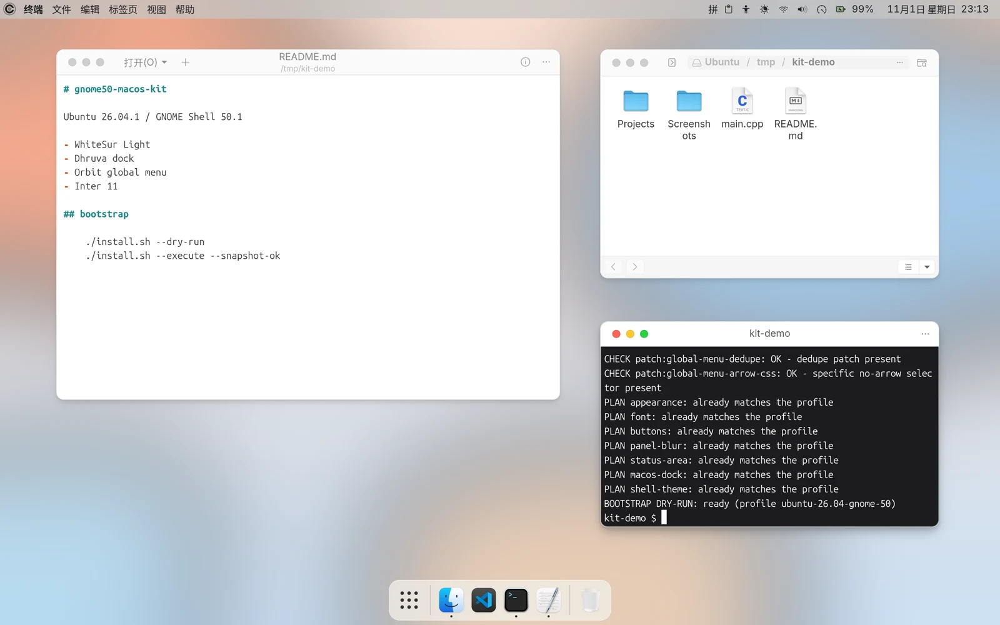

# gnome50-macos-kit

在 Ubuntu 26.04 / GNOME Shell 50.1 上复现 macOS 风格桌面配置的 bootstrap。

它只负责用户级配置：把现有桌面的 GTK、Shell、Dock、顶栏、字体和窗口按钮统一成一套可回滚的配置，不安装主题或扩展。

[](https://github.com/dsyfb437/gnome50-macos-kit/actions/workflows/checks.yml)
[](LICENSE)




> 截图：Text Editor、Files、Terminal；Chrome 不在画面内。

## 开始前

目标环境：

- Ubuntu 26.04.x、GNOME Shell 50.x、Wayland；
- WhiteSur GTK3/GTK4/Shell 主题、WhiteSur 图标和光标、Inter 字体；
- 扩展：User Themes、Blur My Shell、Dhruva、Orbit Global Menu、Just Perfection、Ubuntu AppIndicators、Spotlight；
- Python 3.10+、`gsettings`、`dconf`、`gnome-extensions`、`fc-match`；
- 以普通用户运行，不要用 sudo。

先检查环境：

```bash
python3 desktop.py doctor
```

`doctor` 只读，按主题、图标、字体、扩展、schema 和生成主题列出缺失项。

## 需要手工准备

下面几步依赖上游版本，bootstrap 只检查，不会代做。

### 1. 生成 Shell 主题

```bash
python3 style.py --execute
```

从现有 WhiteSur Shell 主题复制一份，追加 `styles/panel-light.css`，输出到 `~/.themes/WhiteSur-MacOS-Kit`。改 CSS 不需要改 profile。

### 2. 应用补丁

| 补丁 | 目标 | 作用 |
| --- | --- | --- |
| `gtk4-whitesur-light-candidate.patch` | WhiteSur GTK4 `gtk-Light.css` | 修复 8 处 `color-mix` 语法错误 |
| `spotlight-stage-parking.patch` | Spotlight `lib/overview/searchStealer.js` | 修复搜索控件生命周期警告 |
| `global-menu-dedupe-app-menu.patch` | global-menu `nativeMenu.js`、`extension.js` | 同名应用菜单去重 |
| `global-menu-no-arrow-specificity.patch` | global-menu `stylesheet.css` | 隐藏弹出菜单顶部的白色凸起 |

按补丁头部路径手工 `patch -p1` 或编辑，改完重新启用对应扩展/重载主题。

### 3. 启用扩展

确保上面的扩展已安装并启用。

可选中文菜单：

```bash
tools/localize-menus.py chrome nautilus ptyxis --execute
gnome-extensions disable global-menu@unmade.space
gnome-extensions enable global-menu@unmade.space
```

只改 global-menu 的 curated JSON，不改应用本身；恢复用脚本留下的 `.bak-*`。

## 快速开始

完成手工准备后：

```bash
git clone https://github.com/dsyfb437/gnome50-macos-kit.git
cd gnome50-macos-kit

./install.sh --dry-run

# 已有系统快照
./install.sh --execute --snapshot-ok

# 没有 Timeshift/Snapper，接受只做用户级配置备份
./install.sh --execute --no-snapshot
```

报告写入：

```text
~/.local/state/gnome50-macos-kit/bootstrap-reports/<UTC>-<id>.json
```

`--snapshot-ok` 只是声明系统快照已存在；`--no-snapshot` 表示接受没有系统级回滚。

## 它会改什么

| 模块 | 内容 |
| --- | --- |
| `appearance` | WhiteSur Light GTK/图标/光标、prefer-light |
| `font` | Inter 11 |
| `buttons` | 窗口按钮左置（close/minimize/maximize） |
| `panel-blur` | 顶栏模糊开、概览模糊关 |
| `status-area` | 托盘灰度、全局菜单字号 11、面板指示器间距 6 |
| `macos-dock` | Dhruva 浅色半透明 Dock、关闭实时模糊 |
| `shell-theme` | 选中生成的 `WhiteSur-MacOS-Kit` Shell 主题 |

`apply` 单独应用模块，`install` 按固定顺序应用全部；两者默认 dry-run。实际执行由 preflight、plan、apply、verify 组成，失败会自动恢复本次配置备份。

## 回滚

配置备份在：

```text
~/.local/state/gnome50-macos-kit/backups/<UTC>-<id>/
```

手工恢复：

```bash
python3 desktop.py restore --from <BACKUP> \
  --module appearance --module font --module buttons \
  --module panel-blur --module status-area --module macos-dock \
  --module shell-theme --execute
```

备份只覆盖 dconf 值和已纳入模块的文件，不包含系统包、源码补丁或整机快照。系统级回滚请用 Timeshift/Snapper/云厂商快照。

## 验证

```bash
python3 desktop.py                 # 当前状态、扩展、冲突提示（JSON）
python3 desktop.py doctor          # 前置检查
python3 desktop.py verify          # 只读验收，失败返回 1
python3 tests/test_desktop.py      # 24 项隔离测试
python3 tests/test_style.py        # 6 项主题生成工具测试
tests/run-extension-tests.sh       # 可选：对已安装扩展源码跑集成测试
```

CI 运行 Python 语法、主题测试和扩展集成测试；扩展源码不存在时自动跳过。24 项桌面测试需要本地 GNOME 会话，不在 CI 中运行。

## 限制

- 仅支持 GNOME Shell 50.x；跨大版本需要重新验证。
- 不处理登录、指纹、钥匙串、电源、GDM、引导、分区和双系统设置。
- 主题只能统一颜色、圆角、阴影和部分布局，不能把 GTK/AppKit 应用生态变成 macOS；完整 macOS 控制中心不在范围内。
- 部分应用菜单仍可能是英文，取决于 curated JSON 覆盖。

## 目录

```text
install.sh          bootstrap 入口
desktop.py          状态、doctor、apply/install、backup/restore、verify
style.py, styles/   生成 WhiteSur-MacOS-Kit
profiles/           限定环境的 profile
patches/            手工应用的源码补丁
tests/              隔离测试与 profile 契约检查
```

无需 Release：源码即发布，直接 clone 即可。需要离线包时运行 `tools/build-release.sh`。

## License

MIT，见 [LICENSE](LICENSE)。
